


 

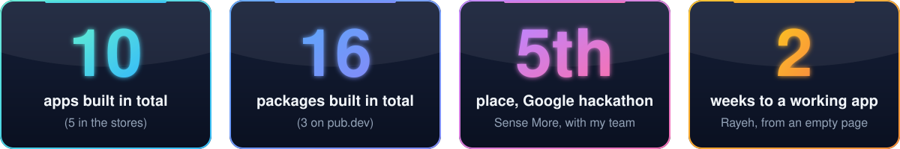

  

**[Portfolio](https://abdelrahman.codesters-inc.com/)**  ·  **[Codesters](https://codesters-inc.com/)**  ·  **[Free apps](https://free.codesters-inc.com/)**  ·  **[Email me](mailto:abdelrahman@codesters-inc.com)**

  

 

  

---

## What I can do, and where I proved it

| Skill | The proof |
|---|---|
| **Ship Flutter apps to real stores** | 10 apps built in total (5 in the stores), end to end in Flutter and Dart. Professional since 2021, now Software Team Lead. |
| **Real-time systems** | HiShare's live billing engine, Cefour's stock that hides a product the moment it sells out, live vehicles moving on Rayeh's map. Real-time chat, WebSockets. |
| **Payments** | Be Trend's wallet with multi-option payments and secure transactions. Stripe, PayTabs and PayPal integrations. The wallet module: top up, withdraw, saved accounts, IBAN checks. |
| **AI products** | InCenter's AI chatbot and recommendation engine. Hawsaba AI: one engine over OpenAI, Anthropic, Gemini and DeepSeek, with streaming, automatic fallback and tool-calling. NutriAI: photograph a meal, get the log and a plan. |
| **Maps and location** | Rayeh's live map, Cefour's nearby offers, Google Maps and heat maps at Alhawsaba, and the `google_place_api` package. |
| **Architecture and shared packages** | Internal packages the whole team builds on, including a design system of 40+ widgets, a chat module, a wallet module and a background uploader. Clean Architecture, MVVM, SOLID. |
| **Security and permissions** | InCenter's e-signatures and encryption, Be Trend's sub-account roles, secure storage in Hawsaba Utils. I wrote a demo that pulls the same API key out of seven Flutter setups, and shows the one that survives. |
| **Performance** | API caching that cuts calls for speed and lower server cost. Memory, app size and battery. |
| **The whole product, alone** | Rayeh: the app, the back end and the admin panel, from an empty page to a working app in two weeks. |
| **Open source** | 16 packages built in total (3 on pub.dev), below. |
| **Lead a team** | Own the team's code review standards at Alhawsaba. |
| **AI-accelerated engineering, human-owned** | Cursor and Claude Code write the first draft; I own the spec, the architecture, the review and the release. Up to 10x more app code per working day on a new app. |

**The stack.** Dart, Flutter, OOP, data structures and algorithms · BLoC (Cubit), GetX, Provider · Clean Architecture, MVVM, SOLID, unit testing · REST, Firebase (Auth, Firestore, Messaging), Google Maps, WebSockets · Jira, Git and GitHub, Postman, Figma, Adobe XD · Cursor and Claude Code, multi-provider LLM engines.

---

## The apps behind the skills

Ten apps built in total, five of them in the stores. Four built end to end at **Alhawsaba (KSA)**, on the Saudi App Store and Google Play. The fifth is my own, **Rayeh**.

<table>
  <tr>
    <td align="center" width="20%">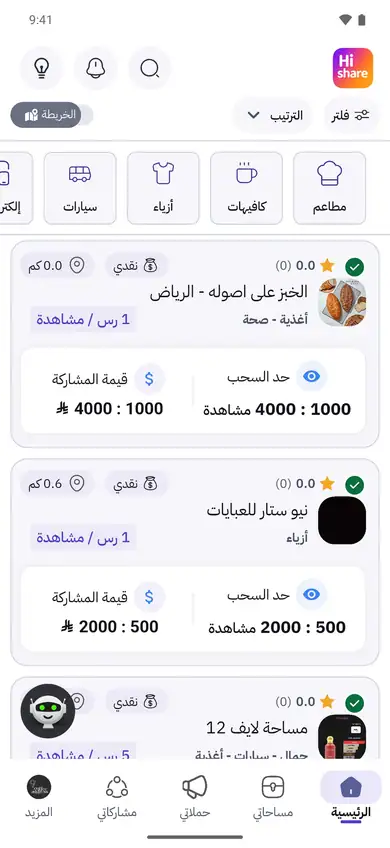</td>
    <td align="center" width="20%">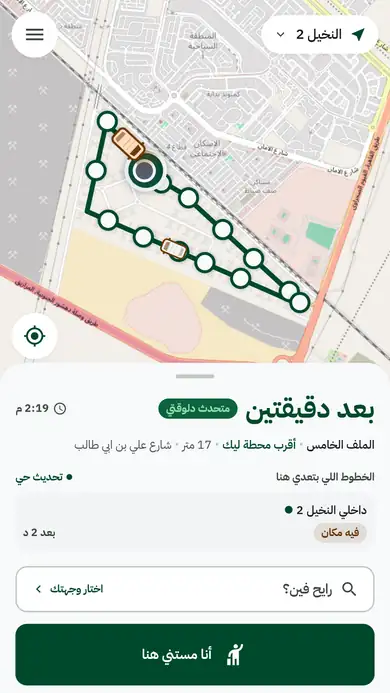</td>
    <td align="center" width="20%">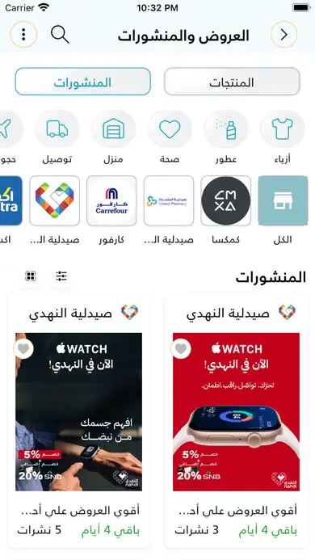</td>
    <td align="center" width="20%">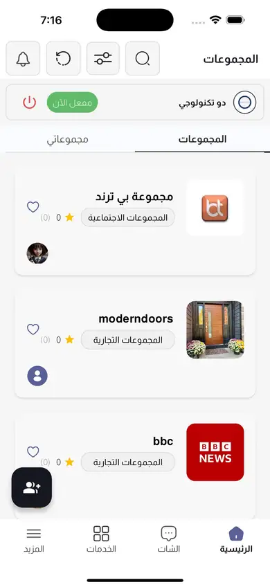</td>
    <td align="center" width="20%">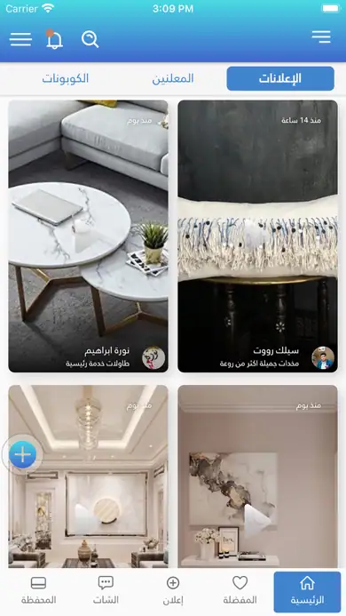</td>
  </tr>
  <tr>
    <td valign="top"><b>HiShare</b> Customers promote you. You pay per view. I built the real-time billing engine that tracks live post views against prepaid budgets.</td>
    <td valign="top"><b>Rayeh (رايح)</b>, in pilot Find your minibus. See it coming. No sign-up. My own free app: I design and build the app, the back end and the admin panel. Piloting in Hadayek October, Egypt.</td>
    <td valign="top"><b>Cefour</b> Every deal, coupon and flyer in Saudi, in one app. I built the real-time stock logic, tiered wholesale and retail pricing, and multi-user store management.</td>
    <td valign="top"><b>InCenter</b> Run sales, brokerage and support from one AI-powered system. I built the AI chatbot, the recommendation engine, e-signatures and encryption.</td>
    <td valign="top"><b>Be Trend</b> Hire the influencer, run the ad, get paid, all in one wallet. I built the wallet, multi-option payments and sub-account roles.</td>
  </tr>
  <tr>
    <td align="center"><a href="https://apps.apple.com/sa/app/%D9%87%D8%A7%D9%8A-%D8%B4%D9%8A%D8%B1/id6739570429">App Store</a> · <a href="https://play.google.com/store/apps/details?id=com.hishare.platform">Google Play</a></td>
    <td align="center"><a href="https://rayeh.pages.dev">Web app</a></td>
    <td align="center"><a href="https://apps.apple.com/sa/app/cefour/id6476445911">App Store</a> · <a href="https://play.google.com/store/apps/details?id=com.cefour.cefour">Google Play</a></td>
    <td align="center"><a href="https://apps.apple.com/sa/app/incenter-%D8%A7%D9%86-%D8%B3%D8%AA%D8%B1/id6739746831">App Store</a> · <a href="https://play.google.com/store/apps/details?id=com.incenter.platform">Google Play</a></td>
    <td align="center"><a href="https://apps.apple.com/sa/app/be-trend-%D8%A8%D9%8A-%D8%AA%D8%B1%D9%86%D8%AF/id1658865427">App Store</a> · <a href="https://play.google.com/store/apps/details?id=com.diwan.beTrend">Google Play</a></td>
  </tr>
</table>

## Career, in order

| When | Where | Role |
|---|---|---|
| Aug 2024 to now | Alhawsaba (KSA), remote | **Software Team Lead.** I design and maintain four internal Flutter packages the team builds on, cut API calls with caching for speed and lower server cost, and own the team's code review standards. |
| May 2023 to Aug 2024 | Alhawsaba (KSA), remote | Senior Software Engineer |
| Jun 2022 to May 2023 | Alhawsaba (KSA), remote | Mid-Level Flutter / Software Engineer |
| Jan 2021 to Jun 2023 | Upwork, freelance | Mobile Application Developer (Flutter). Full iOS and Android apps, pixel-perfect UI from designs, performance work, hard bugs. |
| Now | **Codesters** | Backing new projects. Better services for all. Free. |

## Codesters: new projects deserve backing, communities deserve better services

New projects deserve backing. Communities deserve better services. Both free. So every tool I build there is free to use, and built to cost almost nothing to run.

<table>
  <tr>
    <td align="center" width="25%"></td>
    <td align="center" width="25%">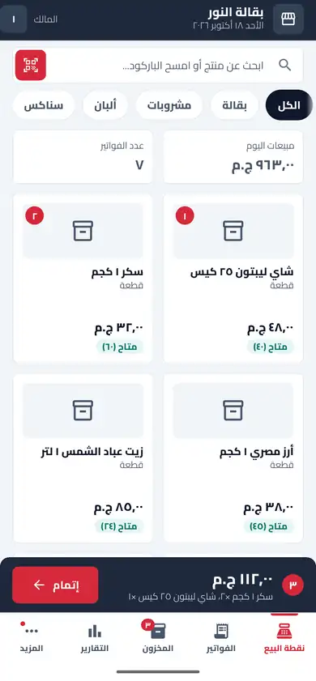</td>
    <td align="center" width="25%">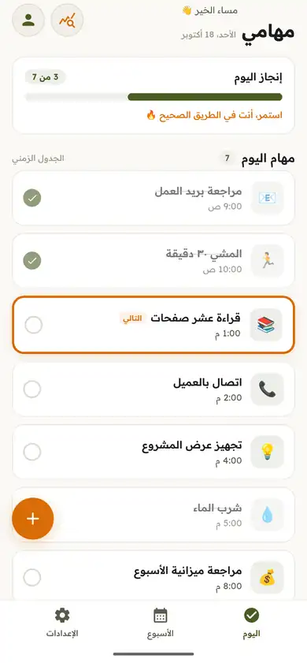</td>
    <td align="center" width="25%"></td>
  </tr>
  <tr>
    <td valign="top"><b>Rayeh (رايح)</b>, free, in pilot Find your minibus. See it coming. No sign-up. Piloting in Hadayek October, Egypt. Empty page to a working app in two weeks.</td>
    <td valign="top"><b>Fatura (فاتورة)</b>, next up A free point of sale for a small shop: sell, issue invoices and watch stock from one phone. No account, no server.</td>
    <td valign="top"><b>Bezra (بذرة)</b>, next up A free daily planner for small habits: a short list for today, reminders from your phone, no account.</td>
    <td valign="top"><b>Whisper Flow</b>, next up Talk, and your words appear in any text box. On your own computer. Arabic and English. Windows first. Built on <a href="https://github.com/cjpais/Handy">Handy</a>, the open-source dictation app by CJ Pais (MIT).</td>
  </tr>
  <tr>
    <td align="center"><a href="https://play.google.com/store/apps/details?id=com.rayeh.app">Google Play</a> · <a href="https://free.codesters-inc.com/">Free site</a></td>
    <td align="center"><a href="https://free.codesters-inc.com/">free.codesters-inc.com</a></td>
    <td align="center"><a href="https://free.codesters-inc.com/">free.codesters-inc.com</a></td>
    <td align="center"><a href="https://free.codesters-inc.com/">free.codesters-inc.com</a></td>
  </tr>
</table>

## Proven on Upwork

Top Rated, 100% Job Success, 5 stars, Rising Talent. Freelance Flutter work since January 2021: full iOS and Android apps, pixel-perfect UI from designs, performance work, hard bugs.

**[See my Upwork profile](https://www.upwork.com/freelancers/abdelrahmanatef4)**

## On GitHub

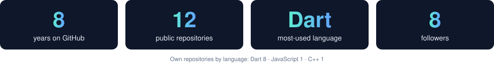

## Open source on pub.dev

| Package | What it does |
|---|---|
| [`multi_reorderable`](https://pub.dev/packages/multi_reorderable) | Multi-selection and animated drag-and-drop reordering for Flutter, with pagination. |
| [`google_place_api`](https://pub.dev/packages/google_place_api) | Google Places client: search, details, photos, autocomplete. |
| [`flutter_rating_bar_plus`](https://pub.dev/packages/flutter_rating_bar_plus) | A maintained fork of `flutter_rating_bar`: customizable, RTL-ready, fractional precision. |

Inside Alhawsaba I also built the shared libraries the whole team ships on: **Hawsaba AI** (a multi-provider engine over OpenAI, Anthropic, Gemini and DeepSeek, with streaming, automatic fallback and tool-calling), **Hawsaba AI Chat**, **Hawsaba Utils**, **Hawsaba UI Kit** (40+ themed widgets), plus chat, wallet, socket, background uploads, file picking and network status. With my own three, that is 16 packages built in total.

## Hackathon: 5th place

<table>
  <tr>
    <td width="150" align="center">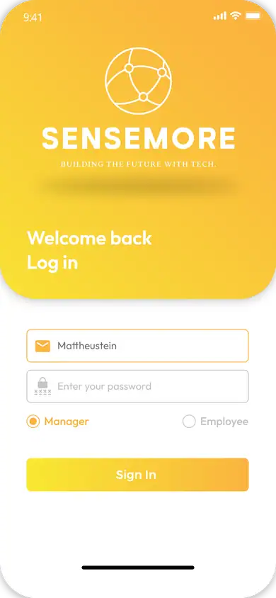</td>
    <td valign="top"><b>Sense More.</b> Know who is in the building, on which floor, and who is on leave. Smart attendance and indoor tracking, built with my team for a Google hackathon. We took <b>5th place</b>.  <a href="https://github.com/abdelrahman-atef1/Sense-More-App">Source</a></td>
  </tr>
</table>

## How I work: AI does the typing, I own the result

Not vibe coding. Cursor and Claude Code write the first draft; I own the spec, the architecture, the review and the release.

- **Spec first.** Data flow, edge cases and acceptance criteria are written before any agent runs.
- **A human reviews every diff**, against SOLID and Clean Architecture.
- **Guardrails before review.** `flutter analyze`, custom lint rules and CI gates run on all agent-touched code.
- **Tests ship with the code**, and I check coverage and edge cases myself.

The result is speed that does not turn into debt: up to **10x more app code per working day** on a new app, measured from version history.

## Contact

[abdelrahman@codesters-inc.com](mailto:abdelrahman@codesters-inc.com)  ·  [support@codesters-inc.com](mailto:support@codesters-inc.com)  ·  Arabic (native), English (B2)

المشاريع الناشئة تستحق الدعم، والمجتمعات تستحق خدمات أفضل. وكلاهما بلا مقابل.

